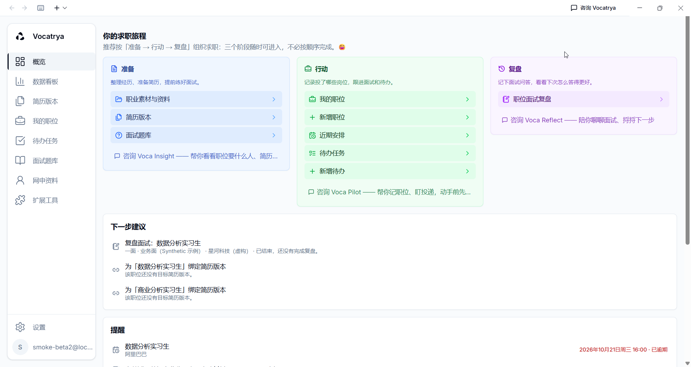
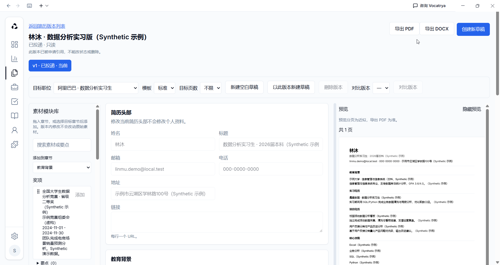
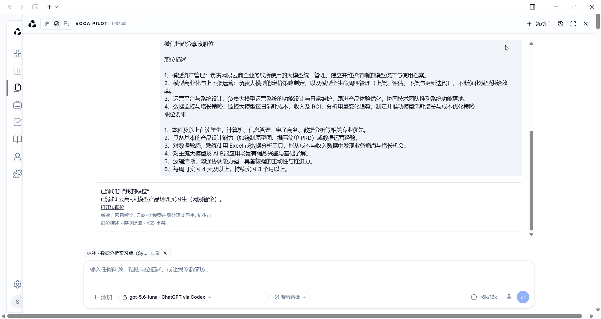
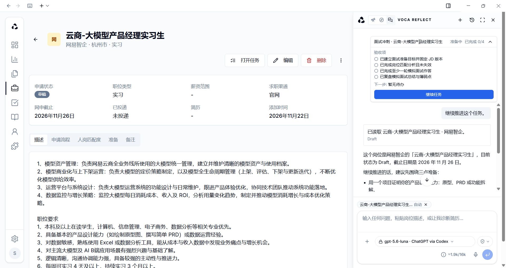

  

<h1 align="center">Vocatrya</h1>

  <strong>A local-first career and job-search manager for the Chinese job market, built as a Windows desktop app</strong>

  
  

  <a href="./README.md">中文</a> · English

---

## What Vocatrya is

Vocatrya is a free, open-source Windows desktop app for the Chinese job market. It brings career information, application progress, and interview debriefs scattered across documents, spreadsheets, and chats into one workflow. Business data stays on your machine by default; connect a model service when you want AI assistance.

## Overview: from resume preparation to interview debriefs

**Career materials → Resume versions → Job opportunities → Applications → Interview debriefs**

Start by organizing your experience. Save employment, projects, education, and skills as reusable materials, then compose resume versions for target roles. When you find an opportunity, record it; when you apply, keep the channel, date, and resume you used. Continue with interview rounds, outcomes, and debriefs so each application informs your next attempt.

The overview is the daily entry point to this journey. Review opportunity, application, interview, and offer statistics alongside tasks and suggested next steps. Those suggestions are generated by rules from existing records; they do not trigger AI calls or execute tasks. The sidebar provides access to resumes, jobs, tasks, interview questions, and application-form tools. See the extension boundaries below for current availability.

*Find the entry points for your current stage and the next steps in one workspace.*

## Resume workspace: materials, evidence, and versions

One experience can support several resumes, each with different wording and content choices. Vocatrya stores materials, evidence, resume versions, and application records separately, so you can keep improving your information while retaining what you submitted.

| Data | What it stores | How it supports the workflow |
| --- | --- | --- |
| Career materials | Employment, projects, education, skills, awards, and their detailed fields | Reusable content for role-specific resumes |
| Evidence | Specific facts and quantified results supporting an experience | Grounds resume statements, with evidence snapshots retained in versions |
| Resume versions | Content, ordering, and presentation selected for a target role | References materials for editing, preview, and export |
| Application records | Channel, date, resume version, and process progress | Preserves each submission without later edits rewriting history |

For example, the same project can appear in a product resume and an operations resume, each emphasizing different results. Compose content from the material library, drag to reorder or hide it, and preview changes live. Export PDF or editable DOCX files when ready. The submitted version is frozen when you apply, so later material updates do not rewrite that application's history.

*Materials, version fields, and preview share one workspace. The submitted version shown is read-only; create a new draft to keep editing.*

## Agent Pilot: AI assistance grounded in your job search

AI assistants can help analyze your information, support everyday work, and reflect on interviews. Vocatrya provides three roles: **Voca Insight (job-search analyst)**, **Voca Pilot (general assistant)**, and **Voca Reflect (reflection coach)**. Available tools vary with the role, connection, and runtime mode.

### Context, tools, and execution results

AI uses inputs relevant to the current task. Sensitive career information such as identity documents and references receives separate protection and is not sent to AI by default. Selecting a suggestion or switching roles does not automatically send a message or execute a suggestion.

Vocatrya orchestrates business tools for ordinary chat. Access to read or modify records depends on roles and permissions; write approval depends on the tool, permission mode, and operation. A written suggestion and an executed action are separate steps. Check application records and execution receipts to establish whether an operation completed.

### Connections and model selection

Connect through a supported official account runtime or bring your own model API (BYOK). After adding a connection, assign default or purpose-specific models from the catalog it actually provides.

Capabilities depend on connection status, runtime version, and account permissions. Requirements for streaming, structured output, and tool calls also vary by purpose. BYOK credentials and charges are managed between you and your provider. A Vocatrya-managed API is not yet available.

### Ordinary chat and Codex native sessions

Codex native sessions are a separate, explicitly selected mode with compatibility and capability gates. Connecting an official account does not automatically inherit search, tools, MCP, or Skills from the official client. Webpage reading is limited to URLs explicitly supplied in the conversation; it is not autonomous search or browser control.

*After pasting a job description, review the creation receipt and open the new job to check the result.*

## Job detail and debriefs: preserve each application's journey

Job opportunities and applications are recorded separately. An opportunity holds the company, role, location, salary, source, and deadline. Each application holds its own channel, date, resume version, and process progress. One opportunity can have repeated applications, with opportunity status and application outcomes maintained separately.

Company information, contacts, interview rounds, and debriefs can be linked to a job. Schedules, round outcomes, and real interview questions have a shared context, so you can look back at what you submitted, what happened, and what to improve next time.

- **Interviews and debriefs:** record rounds, times, and outcomes, then reflect on your performance and experience.
- **Question bank and preparation:** manage interview questions and link preparation materials to jobs for practice and later review.
- **Tasks:** manage to-dos, categories, and deadlines for actions such as preparing materials, practicing for interviews, and following up.
- **Statistics and review:** use application, interview, and offer statistics in the overview to review your progress.
- **Archive and restore:** retain archived jobs and AI conversations and restore them when needed. Business backups are described under data and privacy.

*Use job context to work on interview preparation alongside the detail page, then record rounds and debriefs after the interview.*

Settings also cover language, appearance, display timezone, and desktop tray behavior. The app is in RC iteration; some incremental features still require desktop acceptance. See [release notes](release-notes/) for version changes.

## Quick start

1. Open [GitHub Releases](https://github.com/Shushushu-coder/vocatrya/releases) and choose a version.
2. Download the Windows `.exe` installer from that release's **Assets**.
3. Run the installer, follow the installation prompts, and launch Vocatrya.

## Extensions and current boundaries

- **Notion:** connection and controlled read/write implementations exist; some error and credential boundaries still require acceptance. Operations depend on connection authorization, assistant role, and approval rules.
- **Companion application-form tools:** browser extension and profile pairing/sync implementations are partial, with further work currently paused. Filling a form is not a submitted application; users perform the final submission.
- **Web interview practice:** the standalone entry moves to a web tool whose destination service is not yet connected. This does not remove job-linked interview rounds, questions, or real interview debriefs.

## Data and privacy

- Business data lives in local SQLite and file directories. Backups exclude connection credentials, so reconnect services after restoring.
- Sensitive career information such as identity documents and references receives separate protection and is not sent to AI by default.
- Local-first does not mean offline AI; external AI services and extensions receive relevant inputs.
- Next.js supplies the internal UI and local backend; the browser entry supports development and compatibility checks.

## Contributing and support

Read the [Contributing Guidelines](CONTRIBUTING.md) and [Code of Conduct](CODE_OF_CONDUCT.md). Issues and improvements are welcome, as are stars on [GitHub](https://github.com/Shushushu-coder/vocatrya).

Thanks to upstream JobSync and open-source projects including React, Next.js, Prisma, Electron, Tailwind CSS, shadcn/ui, Tiptap, Nivo, and the Vercel AI SDK.
