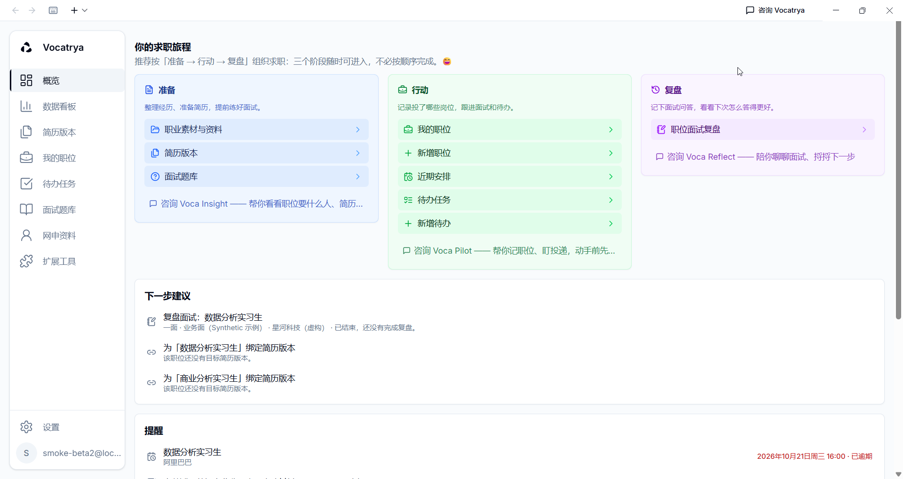
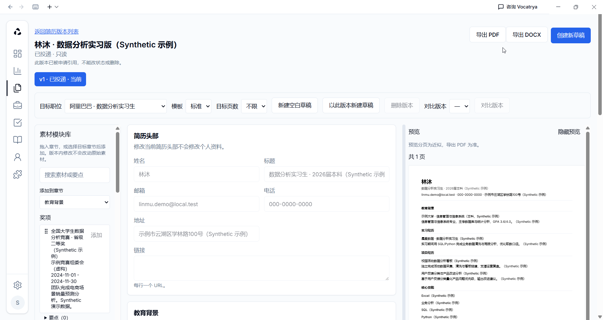
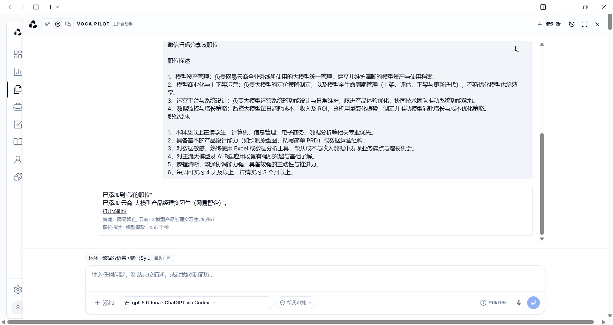
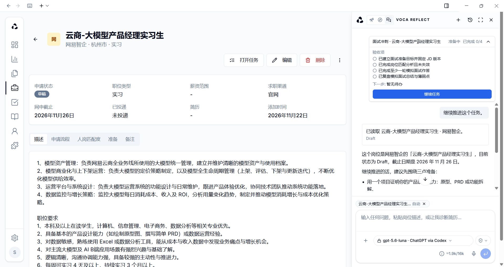

  

<h1 align="center">Vocatrya</h1>

  <strong>面向中国求职市场的本地优先职业与求职管理桌面应用</strong>

  
  

  中文 · <a href="./README.en.md">English</a>

---

## 这个项目是什么

Vocatrya 是面向中国求职市场的免费开源 Windows 桌面应用，把散落在简历文档、表格和聊天记录里的职业资料、投递进展与面试复盘放到同一条工作流中。业务数据默认保存在本机，需要 AI 帮助时再连接模型服务。

## 概览：从准备简历到面试复盘

**职业素材 → 简历版本 → 职位机会 → 实际投递 → 面试复盘**

求职从整理自己的经历开始。把工作、项目、教育和技能保存为可复用的素材，针对目标岗位组合简历版本；发现合适的职位后，记录机会，并在实际申请时留下渠道、时间和所用简历。进入面试后，继续记录轮次、结果与复盘，为下一次准备积累信息。

概览是这条旅程的日常入口：查看职位、实际投递、面试和 Offer 等统计，结合待办与下一步建议决定接下来做什么。下一步建议由已有业务数据按规则生成，不自动发起 AI 调用或执行任务。侧边栏提供简历、职位、任务、题库及网申等相关入口；扩展入口的当前可用范围见下文。

*从准备到行动再到复盘，在同一个工作区找到当前阶段的入口和下一步。*

## 简历工作台：让经历、证据与版本各有归属

一段经历可以用于多份简历，每份简历也可以有不同的表达和内容取舍。Vocatrya 将素材、证据、简历版本和投递记录分别保存，让你能持续更新资料，也能追溯当时投出了什么。

| 数据 | 保存什么 | 如何参与求职流程 |
| --- | --- | --- |
| 职业素材 | 工作、项目、教育、技能、获奖等经历及其详细字段 | 作为不同岗位简历可复用的内容来源 |
| 证据 | 支撑经历的具体事实与量化结果 | 为简历表述提供依据，随版本保留证据快照 |
| 简历版本 | 针对目标岗位选择的内容、顺序与展示方式 | 引用素材，在工作台编辑、预览并导出 |
| 投递记录 | 渠道、时间、所用简历版本及流程进展 | 保留每次实际申请的事实，避免后续修改覆盖历史 |

例如，同一段项目经历可以用于产品岗和运营岗的两份简历，分别突出不同成果。工作台支持从素材库组合内容、拖拽排序或隐藏，并实时预览；完成后可导出 PDF 或可编辑 DOCX。实际投递时冻结所用版本，之后补充素材不会改写这次投递的历史。

*素材库、版本字段与预览放在同一工作台；图中已投递版本为只读，可另建草稿继续调整。*

## Agent Pilot：围绕求职记录使用 AI

在整理资料、推进投递和复盘面试时，可以通过 AI 助手获得分析与建议。Vocatrya 提供三个角色：**Voca Insight（求职分析师）**、**Voca Pilot（全局助手）** 和 **Voca Reflect（复盘教练）**，分别侧重求职分析、日常协助和经历复盘。实际可用工具随角色、连接和运行模式变化。

### 上下文、工具与执行结果

AI 使用与当前任务相关的输入，职业资料中的证件、证明人等敏感信息受独立保护，不默认发送给 AI。选择建议或切换角色不会自动发送消息，也不会自动执行建议。

普通对话由 Vocatrya 编排业务工具；读取或修改记录的能力受角色和权限约束，写入确认取决于工具、权限模式与目标操作。助手给出的文字建议和实际执行是两个步骤，是否完成操作应以应用中的记录和执行回执为准。

### 连接与模型选择

可以通过受支持的官方账号运行时连接 AI，也可以自行接入模型 API（BYOK）。添加连接后，按需要分配默认模型或具体业务用途；可选模型以连接实际提供的目录为准。

可用能力取决于连接状态、运行时版本及账号权限，流式输出、结构化输出与工具调用的要求也因用途而异。自接 API 的凭据和费用由用户与对应服务商管理；Vocatrya 托管 API 尚未推出。

### 普通对话与 Codex 原生会话

Codex 原生会话是需要显式选择的独立模式，受兼容版本与能力门控限制。连接官方账号不代表自动继承官方客户端的搜索、工具、MCP 或 Skills。网页读取限于用户在会话中明确提供的网址，不等同于自主搜索或浏览器操作。

*粘贴职位描述后，Pilot 的执行回执展示新增职位及其入口，方便核对实际结果。*

## 职位详情与复盘：把每次申请的过程留下来

职位机会与实际投递分别记录。前者保存公司、岗位、地点、薪资、来源和截止时间，后者保存每次申请的渠道、时间、简历版本和流程进展。同一个职位可以有多次申请，职位状态与申请结果分开维护。

围绕一个职位，可以关联公司、联系人、面试轮次与复盘。面试安排、各轮结果和真实面试中的问题有了对应的业务背景，回看时可以知道自己投了什么、经历了哪些环节，以及下一次需要改进什么。

- **面试与复盘**：记录轮次、时间和结果，整理真实面试中的表现与经验。
- **题库与准备材料**：管理面试题，将准备材料关联到职位，为面试准备与后续回顾提供依据。
- **任务**：管理求职待办、分类与截止日期，把补充材料、准备面试和跟进进展等后续行动记下来。
- **统计与回顾**：结合概览中的投递、面试与 Offer 统计，回顾求职进展。
- **归档与恢复**：长期保留已归档的职位和 AI 对话，需要时恢复；业务备份另见数据与隐私说明。

*在职位详情旁结合岗位上下文推进面试准备；面试结束后继续记录轮次与复盘。*

还可设置界面语言、外观、显示时区及桌面托盘行为。当前处于 RC 迭代阶段，部分增量功能仍待桌面验收；版本变更见 [更新摘要](release-notes/)。

## 快速开始

1. 打开 [GitHub Releases](https://github.com/Shushushu-coder/vocatrya/releases)，选择要安装的版本。
2. 在该版本的 **Assets** 中下载 Windows `.exe` 安装包。
3. 双击安装包，按提示完成安装，然后启动 Vocatrya。

## 扩展与当前边界

- **Notion：** 已有连接及受控读写实现，仍有异常与凭据边界待验收；可用操作受连接授权、助手角色和审批规则约束。
- **配套网申工具：** 已有浏览器扩展及资料配对同步的部分实现，目前暂停继续推进。填写表单不等于已投递，最终提交仍由用户完成。
- **网页面试练习：** 独立入口转向网页工具，目标服务尚未接入；不影响职位关联的面试轮次、题库和真实面试复盘。

## 数据与隐私

- 业务数据保存在本机 SQLite 数据库及文件目录中。备份不包含连接凭据，恢复后需重新连接服务。
- 职业资料中的证件、证明人等敏感信息受独立保护，不默认发送给 AI。
- local-first 不代表 AI 离线运行；调用外部 AI 或使用扩展时，相关输入会发送给对应服务商。
- Next.js 提供内部界面和本地后端，浏览器入口用于开发与兼容验证。

## 贡献与支持

欢迎提交问题与改进，参与前请阅读 [贡献指南](CONTRIBUTING.md) 和 [行为准则](CODE_OF_CONDUCT.md)。欢迎在 [GitHub](https://github.com/Shushushu-coder/vocatrya) 上给项目一个 Star。

感谢上游 JobSync，以及 React、Next.js、Prisma、Electron、Tailwind CSS、shadcn/ui、Tiptap、Nivo 和 Vercel AI SDK 等开源项目。
